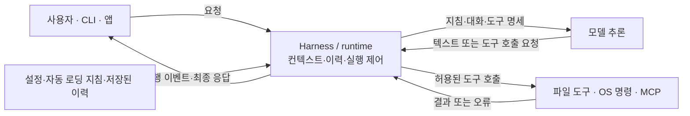

# Agent Runtime Lifecycle 연구

- 작성일: 2026-10-14
- 상태: 연구 진행 중 / 기존 AAA 요구·설계와 제품의 기술적 실행 수명주기를 구분하여 취합
- 목적: 에이전트가 시작하고, 작업하고, 중단·복구하고, 결과와 경험을 남기는 전체 수명주기를 기존 연구와 코드 근거로 정리한다.
- 문서 성격: 연구 노트. 기존 설계의 채택, 새 아키텍처의 확정, 구현 완료를 선언하지 않는다.

## 1. 연구 배경과 범위

사용자는 기존 AAA의 분류와 문서 파편화를 검토하면서 4분할 구조 자체도 재검토하겠다고 밝혔다. 이번 연구는 기존 폴더 배치를 정답으로 삼지 않고 런타임의 실제 동작과 책임을 기준으로 취합한다.

이 연구 문서는 aaaNew/projects/bootstrap/rsch에 둔다. 폴더 생성은 구현이나 상세 설계의 확정을 뜻하지 않는다.

연구 범위는 다음과 같다.

1. 부트스트랩: 시작 시 무엇을 누가 로딩하는가.
2. 정체성·역할·작업·권한: 이번 실행의 주체와 범위는 어떻게 정해지는가.
3. 상태 복원: 이전 실행의 결과와 실제 변경을 어떻게 확인하는가.
4. 컨텍스트: 소스와 기억을 어떤 기준으로 선택하고 갱신하는가.
5. 실행: 작업을 나누고 개별 실행 시도를 어떻게 추적하는가.
6. 결과와 검토: 응답, 산출물, 실제 효과, 완료를 어떻게 구분하는가.
7. 중단·재개·취소·복구: 실행 도중 조건이 바뀌면 어떻게 처리하는가.
8. 기억과 학습: 무엇을 남기고, 검증하고, 다음 실행에서 사용하는가.
9. 종료와 인계: 다음 실행이 추측 없이 이어받으려면 무엇을 보존해야 하는가.

## 2. 취합 기준

- 사용자 지시, 기존 연구의 설계, 코드 정적 관측, 실제 실행 증거, 조사자의 제안을 구분한다.
- 문서의 제목이나 완료 표기만으로 제품 채택·운영 성공을 인정하지 않는다.
- 기존 자료는 원본 경로와 고정 commit으로 참조한다. 원문 전체를 새 문서에 복제하지 않는다.
- 이번 문서는 이미 조사한 근거를 우선 취합한다. 모든 과거 연구를 정독·통합한 최종본은 아니다.
- 기존 AAA 저장소와 branch는 변경하지 않는다. 이 문서 작성 과정에서는 런타임 실행이나 테스트를 수행하지 않았다.

## 3. 기존 AAA 요구·설계의 수명주기

아래 흐름은 기존 연구를 실행 세션 관점에서 종합한 설명이다. AAA 전체 런타임의 실제 동작을 입증한 결과는 아니다.

```text
시작
  → 기본 지침과 실행 설정 로딩
  → 정체성·작업·권한 확인
  → 현재 상태와 이전 효과 복원
  → 필요한 소스·기억 선택
  → 실행 조건 확인 및 개별 시도 수행
  → 결과·실제 효과 확인
  → 검토·수정·완료 판단
  → 다음 작업 / 대기 / 종료

중단·오류·지시 변경 발생
  → 현재 상태와 실제 효과 확인
  → 재개 / 재계획 / 복구 / 보류

검증된 실행 결과와 경험
  → 재사용 후보 검토
  → 허용된 기억 반영
  → 후속 실행에서 사용 및 효과 평가
```

### 3.1 서로 다른 수명

| 대상 | 의미 | 구분해야 하는 점 |
| --- | --- | --- |
| Runtime 세션 | 에이전트가 실행되는 한 구간 | 세션 종료가 사용자 목적 달성을 뜻하지 않는다. |
| Work | 사용자가 달성하려는 목적 | 여러 Task와 여러 세션에 걸칠 수 있다. |
| Task | 목적을 위한 개별 작업 | 해당 작업의 완료 기준을 따로 확인한다. |
| Attempt | 작업을 수행한 개별 시도 | 결과 확보·검증·효과 확인이 필요하다. |
| Persona·Memory | 실행이 사용하는 정체성과 기억 | 세션이나 저장 위치가 바뀌어도 소유권을 새로 만들지 않는다. |

Work·Task·Attempt의 구분과 각각의 완료·종료 조건은 S1·S2의 설계 근거다. Runtime 세션을 위 표처럼 설명한 것은 이번 취합의 관점이며, 기존 연구에 구현된 별도 상태 enum이라고 주장하지 않는다.

### 3.2 결과, 완료, 종료

S1·S2는 생성 → 실행 허용 → 실행 중 → 결과 확보 → 검증 → 완료 인정 → 종료 정리를 구분한다. 대기·차단·실패·취소는 각 원인과 근거를 따로 남긴다.

모델 응답의 종료, Attempt의 성공, Task의 완료, Work의 목적 달성은 각각 확인해야 한다. 하위 작업의 종료가 상위 작업을 자동으로 완료시키지는 않는다.

검토에서 수정이 필요하면 수정된 버전을 대상으로 영향 범위를 재검증한다. 검토 완료와 사용자 수용도 별도로 다룬다.

### 3.3 중단과 복구

S1·S2는 정지 요청과 실제 정지 관측, 취소와 이미 발생한 변경의 되돌리기를 구분한다. 재개할 때 현재 권한·입력 버전·실제 효과를 다시 확인한다.

변경 여부가 불명확하면 기존 실행과 대상을 먼저 조회한다. 응답 유실이나 시간 초과만으로 아무 변경도 없었다고 간주하지 않는다. 이미 확인된 변경은 중복 수행하지 않는다. 이러한 판단의 일부는 S5·S6 코드에서도 정적으로 확인했다.

### 3.4 컨텍스트와 기억

S1은 원본의 정확한 버전과 적용 범위를 확인한 뒤 필요한 자료를 선택하는 ContextPlan을 설계한다. 작업 전환, 중요한 결과, 정보 부족, 검토 지적 등 유효한 변화가 생기면 다시 평가한다.

경험은 즉시 확정된 지식이나 규칙이 되지 않는다. 관측과 해석을 구분하고, 재사용 후보의 검증과 반영 허용을 거친다. 정책·Skill 변경은 별도 권한 경로다.

Current는 현재 작업 상태를 보여주는 요약이라는 설계 의미를 가진다. 정확한 원본과 권한을 대신하는 새 정본으로 취급하지 않는다.

## 4. Codex와 Claude Code의 기술적 runtime lifecycle

### 4.1 조사 범위

2026-10-14 공식 문서와 OpenAI의 공개 기술 설명을 확인했다. 로컬 명령으로 확인한 버전은 codex-cli 0.157.1, Claude Code 2.1.268이다. 이 CLI 버전을 현재 데스크톱 앱 내부 서버 버전이나 다른 실행 중인 세션의 버전과 동일하다고 간주하지 않는다.

이 절은 실제 제품이 공개한 프로그램·프로토콜·hook 동작을 설명한다. §3의 AAA 요구·설계와 구분한다. 새 에이전트 세션을 실행해 내부 이벤트 전체를 계측한 결과는 아니며, 문서에 공개되지 않은 내부 호출 순서는 확정하지 않는다. 공식 문서의 최신 기능이 로컬 설치 버전에도 모두 있다는 뜻은 아니다.

### 4.2 실제로 일을 나누어 하는 구성 요소



파일을 읽고 명령을 실행하는 주체는 runtime과 도구 구현이다. 모델은 전달받은 입력을 바탕으로 다음 텍스트나 도구 호출을 생성한다. 도구 결과를 다음 입력에 넣어 모델을 다시 부르는 반복이 agent loop다. 사용자 요청 한 건에 모델 호출은 여러 번 발생할 수 있다. [S11·S13]

| 수명 | 기술적 의미 | 반복 시점 |
| --- | --- | --- |
| 프로세스·연결 | 프로그램 실행, 설정과 연결 준비 | 앱·CLI·서버 시작 또는 재연결 |
| 세션 / thread | 대화 상태의 생성·복원·보관 | 새 대화 또는 재개 |
| turn | 사용자 입력을 받아 응답을 끝낼 때까지 | 요청 한 건. 실행 중 추가 입력은 같은 turn에 들어갈 수도 있음 |
| 모델·도구 반복 | 입력 구성 → 추론 → 도구 실행 → 결과 추가 | 한 turn 안에서 필요한 만큼 |

### 4.3 Codex: App Server와 core의 처리 경로

App Server는 클라이언트와 JSON-RPC로 통신하고, thread별 Codex core 세션을 관리한다. core가 agent loop와 대화 상태를 관리한다. CLI와 App Server의 UI 접점은 다르므로 모든 CLI 입력이 반드시 turn/start JSON-RPC를 통과한다고 일반화하지 않는다. [S16]

```text
연결 시작: initialize → initialized                         [연결당 준비]
대화 준비: thread/start 또는 thread/resume                  [생성·복원]
요청 접수: turn/start(threadId, input) → turn/started       [turn 시작]
    → 모델 입력 구성 → 추론 요청
    → 도구 호출이 있으면 정책·승인 처리 → 도구 실행
    → 도구 결과를 이력에 추가 → 다시 추론
    → 최종 응답 → turn/completed
```

실행 중에는 item/started, item/*/delta, item/completed 등으로 개별 메시지·도구 작업을 UI에 전달한다. 승인이 필요한 호출은 클라이언트 응답을 기다릴 수 있다. 종료 상태는 completed, interrupted, failed로 구분한다. 기존 연결과 thread가 있으면 매 사용자 요청마다 다시 생성하지 않는다. [S12]

모델 입력에는 기본 지침, 적용 권한·환경 정보, 프로젝트 지침, 대화와 도구 결과, 현재 요청, 도구 정의 등이 들어간다. 실제 wire 표현은 provider와 버전에 의존한다. 프로그램이 구성하는 모델 입력과 서버 내부의 최종 프롬프트 배열을 동일한 것으로 단정하지 않는다. [S11]

### 4.4 Claude Code: 세션과 hook으로 관찰되는 경계

세션 준비에서 설정·도구·CLAUDE.md 등 지침과 활성화된 기억을 준비하고, 재개라면 저장된 대화를 복원한다. SessionStart는 시작·재개 등에 연결되는 이벤트다. 이 로딩 작업들의 모든 세부 실행 순서가 아래처럼 직렬이라는 뜻은 아니다. [S13–S15]

```text
사용자 입력
  → UserPromptSubmit                      [설정된 hook: 추가 맥락·차단 가능]
  → 모델 입력 구성 → Claude 모델 호출
  → 도구 요청
      → PreToolUse                        [도구 매개변수 생성 후]
      → 권한 처리 / 필요 시 PermissionRequest
      → 실제 도구 실행
      → PostToolUse 또는 PostToolUseFailure
      → 결과를 대화에 넣고 다시 모델 호출
  → 최종 응답 / Stop                      [추가 작업 요구 시 루프 계속]
  → 다음 사용자 입력 대기
```

hook 이름은 실행 경계다. 해당 hook이 설정되어 있지 않으면 사용자 hook 프로그램을 실행하지 않는다. Stop은 정상 응답 종료와 관련되며 사용자 중단 때는 발생하지 않는다. 세션 자체의 종료 이벤트 SessionEnd와도 구분한다. [S14]

### 4.5 지침 파일은 언제 읽히는가

| 대상 | 프로그램의 자동 로딩 | 이후 모델·도구가 하는 읽기 |
| --- | --- | --- |
| Codex AGENTS.md 계열 | 실행 시작에 적용 탐색 범위의 내용을 초기 지침에 포함 | 연결된 일반 문서 전체를 자동으로 따라 읽는 것은 아님 [S8] |
| Claude Code CLAUDE.md | 시작 시 적용 범위와 @import를 로딩. 하위 경로 지침은 해당 경로 작업 시 추가 로딩될 수 있음 | 일반 문서 읽기는 별도 도구 호출 [S15] |
| Skill | 시작 시 이름·설명 등 발견용 정보 제공 | 선택·호출 시 본문을 추가 [S11·S13] |
| Claude auto memory | 활성화된 경우 시작 시 MEMORY.md의 제한된 범위 로딩 | 주제별 상세 기억은 필요할 때 읽음 [S15] |
| 코드·README·CURRENT·연구 문서 | 파일이 존재한다는 이유만으로 전부 로딩되지는 않음 | 요청·지침·관측 결과에 따라 모델이 읽기 도구를 선택 |

이 PC의 Claude Code 2.1.268에는 최신 문서의 AGENTS.md 직접 자동 로딩 기능을 적용했다고 말할 수 없다. 공식 문서가 명시한 도입 버전은 2.1.277이다. 이전 버전에서 CLAUDE.md의 @AGENTS.md import와 “AGENTS.md를 읽어라”라는 자연어 지시는 다른 동작이다. import는 로더가 확장하고, 자연어 지시는 모델의 후속 파일 읽기에 의존한다. 실제 설정은 이번 조사에서 바꾸지 않았다. [S15]

### 4.6 종료·중단·압축·재개

- Codex: turn/steer는 실행 중인 turn에 입력을 추가한다. turn/interrupt는 중단을 요청하고, thread/resume는 보관된 thread를 다시 불러온다. contextCompaction은 컨텍스트 압축을 나타내는 item이다. [S12]
- Claude Code: 실행 중 추가 메시지는 queue를 통해 반영될 수 있다. --resume·--continue는 기존 세션을 이어간다. 컨텍스트가 차면 도구 출력 정리와 대화 요약을 수행한다. [S13]
- 세션 로그는 대화와 실행 이력을 보존하는 장치다. 모델 자체의 학습이나 장기 기억의 검증·승격과 동일하지 않다.
- 최종 답변은 turn의 실행 종료를 나타낸다. 테스트 통과나 사용자 목적 달성은 별도의 결과 근거가 있어야 한다.

### 4.7 부트스트랩 연구에서 구분할 기술적 위치

1. 첫 모델 호출 전에 프로그램이 넣는 지침·환경·도구·이력.
2. 입력 접수와 도구 실행 경계에서 동작하는 hook·정책 처리.
3. 모델의 판단으로 이루어지는 후속 파일 읽기와 도구 실행.

예를 들어 “항상 X를 먼저 읽어라”를 지침에 쓰는 것은 3번을 유도한다. X를 시작 시 loader/import/hook 출력으로 실제 입력에 포함시키는 것은 1번 또는 2번의 구현이다. 어떤 방식으로 문서를 전달하는지와 그 문서가 무엇을 요구하는지를 따로 조사해야 한다.

## 5. 소스·실행 상태·기억의 관계

이 대화에서 조사자는 소스와 실행 중 축적되는 기억을 분리하고, 사용 시에는 하나의 진입점에서 필요한 내용을 조합하는 방안을 제안했다. 사용자 채택은 확인되지 않았으며 연구 선택지로 유지한다.

| 구분 | 다루는 내용 | 검토할 관리 기준 |
| --- | --- | --- |
| 소스 | 코드·원본 문서·명시적 결정의 근거 | 원본 소유자, 정확한 버전, 변경 검토 |
| 실행 상태 | 현재 작업, 실제 변경, 미확인 효과, 복구 단서 | 실행 식별자, 내구성, 재개·중복 방지 |
| 기억 | 경험에서 얻은 지식·선호·재사용할 맥락 | 소유자, 적용 범위, 근거, 유효성·정정 |

논리적 구분과 물리적 저장소 분리는 다른 결정이다. 별도 Git 저장소나 데이터베이스의 종류·개수는 정하지 않았다. 소스가 바뀌면 관련 기억의 유효성을 확인하고, 저장 위치 변경으로 기억의 소유권을 바꾸지 않는 관계를 검토한다.

## 6. 구현에서 확인된 범위

| 대상 | 기존 조사에서 확인한 내용 | 확인하지 못한 범위 |
| --- | --- | --- |
| main Work Harness | 실행 준비, provider 경계, 결과 보관, 상태·효과 구분, 복구 판단의 코드 | 전체 AAA 제품의 실제 운영 완료 |
| main Planning Context | 컨텍스트·연속 실행·결과 반영 관련 라이브러리 | 통합된 운영 상태·기억 저장소. CandidateStore는 임시 경로 사용을 제한 조건으로 둠 |
| main Persona Lifecycle | Persona 상태·binding·저장 및 일부 native 경계 코드 | 전체 제품의 정체성·권한 연결이 운영에서 입증됐는지 |
| P5A | 가짜 저장소·provider 등을 이용하는 수명주기 실험 코드 | 실제 provider·운영 저장소의 동작 |
| P5B | Pi 실행 어댑터와 제한된 실행 경로의 코드 | 이번 조사에서의 실행 성공·운영 채택 |

근거는 S4–S7과 S10이다. 코드 존재, 과거 테스트 기록, 이번 조사에서 실행한 검증은 서로 다른 증거다. 이번 취합에서는 실행 검증을 하지 않았다.

## 7. 근거 자료

고정 snapshot은 기존 구조 조사 때 확보한 것이다. 현재 원격 최신 상태를 다시 조회한 결과가 아니다.

| 식별자 | 대상 | 고정 commit |
| --- | --- | --- |
| M | 조사 당시 AAA main | 9ec67c5435f3e4d6dd28f3e94eec007df881031e |
| S | 조사 당시 SLR 원격 연구 snapshot | 05966e0951d87ffa2f9a9d4cc465dc62a0548c68 |
| A | 조사 당시 로컬 P5A | 272b32351bfc8caf82aec18a3ca82354b140ad04 |
| B | 조사 당시 로컬 P5B | 85d533a6e6461b8f812c4b067260cbe78f9d29c0 |

| ID | 자료 | 취합에서의 용도와 한계 |
| --- | --- | --- |
| S1 | [ARCP System Architecture v1.1](https://github.com/AofSpds/AAA/blob/05966e0951d87ffa2f9a9d4cc465dc62a0548c68/projects/AAA/subplans/SE-SELF-LEARNING-RUNTIME/work/architecture/20261005-arcp-formal-architecture/results/ARCP_SYSTEM_ARCHITECTURE_v1.1.md) | §7 수명주기, §8 컨텍스트, §11 경험·학습, §14 복구. 설계 근거 |
| S2 | [ARCP Detailed Composition v1.0](https://github.com/AofSpds/AAA/blob/05966e0951d87ffa2f9a9d4cc465dc62a0548c68/projects/AAA/subplans/SE-SELF-LEARNING-RUNTIME/work/architecture/20261008-arcp-composition-draft/results/ARCP_DETAILED_COMPOSITION_ARCHITECTURE_v1.0.md) | §8 상태 구분, §9 정상·실패 시퀀스. 구성 후보 |
| S3 | [Formal Architecture Handoff](https://github.com/AofSpds/AAA/blob/05966e0951d87ffa2f9a9d4cc465dc62a0548c68/projects/AAA/subplans/SE-SELF-LEARNING-RUNTIME/work/architecture/20261005-arcp-formal-architecture/results/FINAL_ARCHITECTURE_HANDOFF.md) | 후속 설계 사용 인수와 선언된 미확정 연결 조건. Owner 최종 승인·운영 채택의 증명이 아님 |
| S4 | [Work Harness contract.mjs](https://github.com/AofSpds/AAA/blob/9ec67c5435f3e4d6dd28f3e94eec007df881031e/core/implementation/work-harness/src/contract.mjs) | 실행·효과·결과·검증 축의 코드 |
| S5 | [Planning Context continuity.py](https://github.com/AofSpds/AAA/blob/9ec67c5435f3e4d6dd28f3e94eec007df881031e/core/implementation/planning-context/continuity.py) | 연속 실행과 효과 확인의 코드 |
| S6 | [Work Harness recovery.mjs](https://github.com/AofSpds/AAA/blob/9ec67c5435f3e4d6dd28f3e94eec007df881031e/core/implementation/work-harness/src/recovery.mjs) | 재전송·재실행 전 복구 판단의 코드 |
| S7 | [Planning Context store.py](https://github.com/AofSpds/AAA/blob/9ec67c5435f3e4d6dd28f3e94eec007df881031e/core/implementation/planning-context/store.py) | 임시 CandidateStore의 저장·조회 경계 |
| S8 | [OpenAI 공식 AGENTS.md 문서](https://learn.chatgpt.com/docs/agent-configuration/agents-md) | 2026-10-14 열람. Codex 동작의 근거이며 AAA 자체 구현 증거가 아님 |
| S9 | 기존 R3 아키텍처 조사 (로컬 원본 삭제됨) | 기존 설계 계보와 대응. 2차 조사 자료 |
| S10 | 기존 R4 코드 조사 (로컬 원본 삭제됨) | main·P5A·P5B 코드 및 검증 범위. 2차 조사 자료 |
| S11 | [OpenAI: Unrolling the Codex agent loop](https://openai.com/index/unrolling-the-codex-agent-loop/) | 모델 입력 구성과 추론·도구 반복의 공개 기술 설명. 2026-10-14 열람 |
| S12 | [Codex App Server](https://learn.chatgpt.com/docs/app-server) | 연결·thread·turn·item의 공개 프로토콜. 2026-10-14 열람 |
| S13 | [How Claude Code works](https://code.claude.com/docs/en/how-claude-code-works) | harness, 도구, 세션, 컨텍스트 처리의 공식 설명. 2026-10-14 열람 |
| S14 | [Claude Code hooks reference](https://code.claude.com/docs/en/hooks) | 입력·도구·종료 경계의 공개 hook. 버전별 지원 차이에 유의. 2026-10-14 열람 |
| S15 | [How Claude remembers your project](https://code.claude.com/docs/en/memory) | CLAUDE.md·import·auto memory·AGENTS.md 지원 버전. 2026-10-14 열람 |
| S16 | [OpenAI: Unlocking the Codex harness](https://openai.com/index/unlocking-the-codex-harness/) | App Server, thread manager, Codex core의 관계. 2026-10-14 열람 |

S9·S10은 이 문서 작성 당시 읽은 2차 조사 자료다. 이후 사용자 지시에 따라 aaa-restructure-research 폴더를 삭제했으므로 이 문서에서 해당 로컬 자료를 다시 열 수 없다. P5A·P5B는 위 로컬 commit으로 식별하며, 추가 검증 시 원본 코드와 실행 증거를 다시 확인한다. 원격에서 접근 가능하다고 확인하지 않은 commit에 GitHub 링크를 만들지 않는다.

## 8. 다음 취합 항목

- [ ] 기존 운영루프·Persona 연구에서 runtime 시작·종료·인계 조건을 추가 대조한다.
- [x] Codex·Claude Code의 세션 초기화, turn, 모델·도구 반복, 종료·재개를 기술적으로 정리한다 (§4).
- [x] 자동 지침 로딩·import와 모델의 후속 파일 읽기를 구분한다 (§4.5). 로컬 버전과 공식 문서의 기능 차이를 기록한다.
- [ ] 정상 실행, 중단 후 재개, 외부 효과 불명, 지시 변경, 종료 후 새 세션 진입을 구체적인 사례로 비교한다.
- [ ] 원본 요구, 설계, 실제 코드, 실행 증거를 연결하고 빈 구간을 표시한다.
- [ ] 기억의 소유·유효성·정정과 실행 상태의 보존·복구를 구분해 비교한다.
- [ ] 통합 런타임 동작을 입증하는 데 필요한 최소 검증 사례를 제안한다.

위 항목은 후속 연구 주제다. 이번 파일 생성으로 실행·배차·기존 코드 이전을 시작하지 않는다.